# Pruebas funcionales del formulario de contratación

> **Proyecto:** Mercedes-Benz · Desarrollo de Interfaces · Práctica 2<br>
> **Tarea:** T13 · SCRUM-18<br>
> **Rama:** `feat/pruebas`<br>
> **Fecha de ejecución:** 17/11/2026<br>
> **Ámbito:** formulario de contratación de seis pasos, validaciones JavaScript, resumen, pago simulado y confirmación en la home.

## 1. Entorno y método

| Elemento | Valor |
|---|---|
| Sistema operativo | Windows 11 (NT 10.0.26200.0) |
| Navegador | Google Chrome 156.0.8078.82 |
| Vista de escritorio | 1440 × 1000 px |
| Vista móvil | 390 × 844 px |
| Automatización | Node.js 24.15.0 + Chrome DevTools Protocol |
| Servidor local | `http://127.0.0.1:8765` |
| Datos | Ficticios; sin backend, sin pasarela real y sin cobros |

Cada prueba parte de `contratacion.html` con el estado limpio. El arnés rellena los campos, pulsa **Siguiente** o **Confirmar solicitud** y lee del DOM el paso visible, el elemento que tiene el foco, los errores en línea y el resumen de errores. Las capturas están guardadas en esta misma carpeta `docs/`.

**Datos base del recorrido válido:**

```text
Producto: Clase A 250e (12.467 € de aportación + 295 €/mes)
Nombre: Ana
Apellidos: García López
DNI: 12345678Z
Correo: ana.garcia@example.com
Teléfono: 612 345 678
Fecha de nacimiento: 1990-01-01
Dirección: Calle Alcalá 50, 3º B, 28014 Madrid, provincia 28
IBAN: ES91 2100 0418 4502 0005 1332
Tarjeta: 4242 4242 4242 4242, 12/30, CVV 123
```

## 2. Resultados de las 12 pruebas

| # | Prueba | Datos ficticios | Resultado esperado | Resultado obtenido | OK/KO | Evidencia |
|---|---|---|---|---|---|---|
| 1 | Vacíos y espacios | Producto Clase A; paso 3 con nombre `"   "`, apellidos `"  "` y el resto vacío | No avanza, muestra el resumen, enfoca el primer campo obligatorio y explica cada error | Se queda en el paso 3; foco en `#nombre`; 7 errores y 7 enlaces en el resumen. Mensajes: `Introduce tu nombre.`, `Introduce tus apellidos.`, `Introduce tu DNI.`, `Introduce tu fecha de nacimiento.`, `Introduce tu correo electrónico.`, `Confirma tu correo electrónico.`, `Introduce tu teléfono.` | OK | [t13-01-vacios.png](t13-01-vacios.png) |
| 2 | Correo y teléfono | Correo `ana.garcia@`; confirmación `ana.garcia@example.com`; teléfono `51234567` | Detecta el formato del correo, la confirmación distinta y el teléfono inválido | 3 errores: `Introduce un correo electrónico válido.`, `Los correos electrónicos no coinciden.`, `Introduce un teléfono español de 9 cifras que empiece por 6, 7, 8 o 9.`; foco en `#email`. Con `+34 612 345 678` normaliza y avanza al paso 4 | OK | [t13-02-contacto.png](t13-02-contacto.png) |
| 3 | DNI | DNI `12345678A` y después `12345678Z` | Rechaza la letra de control incorrecta y acepta el DNI válido | `Introduce un DNI válido: 8 cifras y letra de control.`; foco en `#dni`. Con `12345678Z` avanza al paso 4 | OK | [t13-03-dni.png](t13-03-dni.png) |
| 4 | Edad | `2008-11-17` (18 años el día de la prueba), `2008-11-18` y `2026-11-18` | Acepta el día que se cumplen 18 años; rechaza el día anterior y la fecha futura | `2008-11-17` avanza al paso 4. `2008-11-18` muestra `Debes ser mayor de 18 años.` y `2026-11-18` muestra `La fecha de nacimiento no puede estar en el futuro.`; foco en `#fechaNacimiento` | OK | [t13-04-edad.png](t13-04-edad.png) |
| 5 | Dirección | CP `28014` con provincia `08`; después provincia `28`; después CP `00280` | Rechaza el CP incompatible y el prefijo fuera de 01-52; acepta la combinación correcta | `El código postal no corresponde a la provincia seleccionada.`; foco en `#codigoPostal`. Con provincia `28` avanza al paso 5. `00280` muestra `El prefijo del código postal no es válido (01-52).` | OK | [t13-05-direccion.png](t13-05-direccion.png) |
| 6 | Productos | Sin producto; AMG + Pack AMG Night + Pack Confort; Clase A + Wallbox y cambio a AMG | Bloquea la ausencia de producto y la combinación incompatible; al cambiar de producto retira los extras que ya no aplican | Sin producto: paso 1, foco en `#producto-clase-a`, `Selecciona un vehículo.` Al marcar Pack AMG Night, Pack Confort queda deshabilitado y su tarjeta muestra `No compatible con Pack AMG Night.`; el intento de marcarlo no cambia el estado. A la inversa, Pack Confort deshabilita Pack AMG Night y muestra `No compatible con Pack Confort.` Al pasar de Clase A con Wallbox a AMG, Wallbox se desmarca y aparece `Se ha quitado 1 extra que no está disponible para el vehículo seleccionado.` | OK | [t13-06-extras.png](t13-06-extras.png) |
| 7 | IBAN | `ES91 2100 0418 4502 0005 1333` y después `...1332` | Rechaza un IBAN con formato correcto pero dígitos de control incorrectos | `Introduce un IBAN español válido: ES + 22 cifras y dígitos de control.`; foco en `#iban`. Con `...1332` avanza al paso 6 | OK | [t13-07-iban.png](t13-07-iban.png) |
| 8 | Tarjeta | Número `4242 4242 4242 4241`; caducidad `01/20`; CVV `12`; después datos válidos | Detecta Luhn incorrecto, tarjeta caducada y CVV inválido; acepta los datos válidos | `El número de la tarjeta no es válido (Luhn).`; foco en `#numeroTarjeta`. Después: `La tarjeta está caducada.` y `El CVV debe tener 3 cifras.` Con `4242 4242 4242 4242`, `12/30` y `123` avanza al paso 6 | OK | [t13-08-tarjeta.png](t13-08-tarjeta.png) |
| 9 | Cambio de pago | Domiciliación con IBAN válido y tarjeta inactiva con datos inválidos; después tarjeta con CVV `12` e IBAN vacío | Ignora los campos del método inactivo y exige solo los del método activo | Con domiciliación avanza al paso 6 sin errores y el resumen muestra `Domiciliación bancaria · •••• 1332`. Con tarjeta se queda en el paso 5 solo por `El CVV debe tener 3 cifras.`; no exige IBAN ni titular de cuenta. Al corregir, el resumen muestra `Tarjeta simulada · •••• 4242` | OK | [t13-09-pago.png](t13-09-pago.png) |
| 10 | Casillas | Sin casillas; solo condiciones; ambas con la comercial desmarcada | Exige las dos obligatorias y permite rechazar la publicidad | Sin casillas: `Debes aceptar las condiciones de contratación.` y `Debes aceptar la política de privacidad.`; foco en `#aceptoCondiciones`. Solo condiciones: permanece el error de privacidad. Con ambas: modal de confirmación en la home y la casilla comercial sin marcar | OK | [t13-10-casillas.png](t13-10-casillas.png) |
| 11 | KO y corrección | Nombre `"   "`, apellidos `García López`, DNI `12345678A`, fecha `2010-01-01`, correo válido, confirmación `otra@example.com`, teléfono `51234567` | Muestra varios errores, abre el primer paso afectado, enfoca el primer campo, conserva los datos y actualiza los errores al corregir | 5 errores y 5 enlaces; foco en `#nombre`; `García López` se conserva. Al corregir, el resumen baja a 0 y avanza al paso 4. Prueba entre pasos: desde el paso 6, `Config.validarTodo()` con el nombre vacío abre el paso 3, enfoca `#nombre` y muestra 3 enlaces | OK | [t13-11-correccion.png](t13-11-correccion.png) |
| 12 | Recorrido OK | Todos los datos válidos, incluida la aceptación de las dos casillas obligatorias | Vuelve a la home, muestra el modal una vez y no lo repite al recargar | URL final `/index.html` sin query; modal `Solicitud registrada correctamente`; `sessionStorage` limpio. Se cierra correctamente. Al recargar y al entrar directamente en la home no vuelve a aparecer. 0 errores de consola | OK | [t13-12-modal.png](t13-12-modal.png) |

## 2.1. Galería de evidencias

Las capturas están incrustadas aquí para que se puedan ver directamente desde el documento. También siguen disponibles como archivos independientes en `docs/`.

### Prueba 1 · Vacíos y espacios


### Prueba 2 · Correo y teléfono

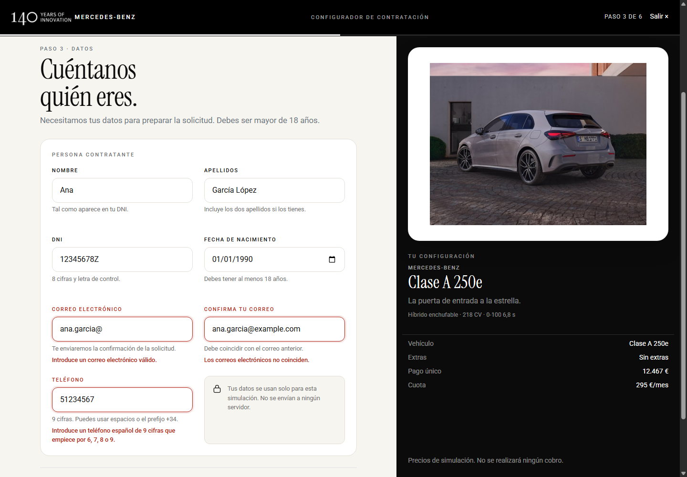

### Prueba 3 · DNI

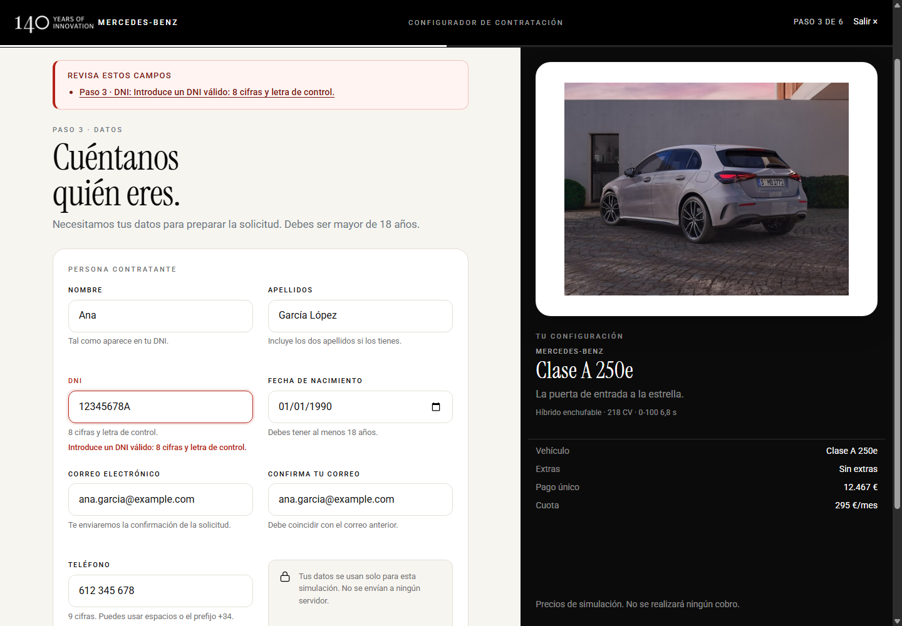

### Prueba 4 · Edad

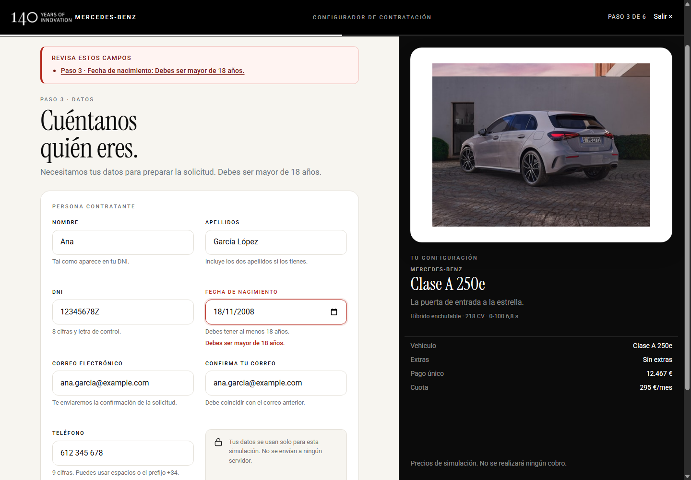

### Prueba 5 · Dirección

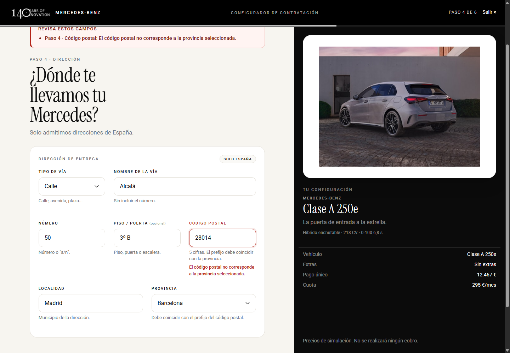

### Prueba 6 · Productos

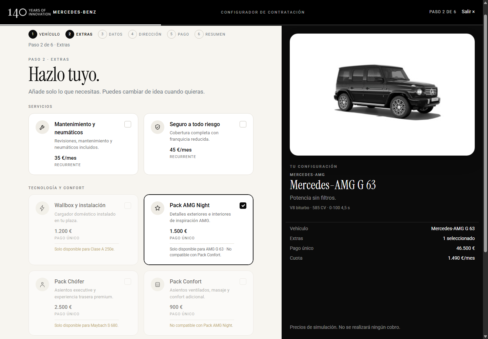

### Prueba 7 · IBAN

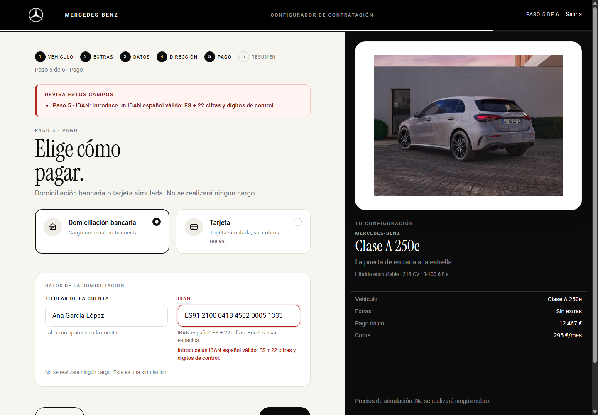

### Prueba 8 · Tarjeta

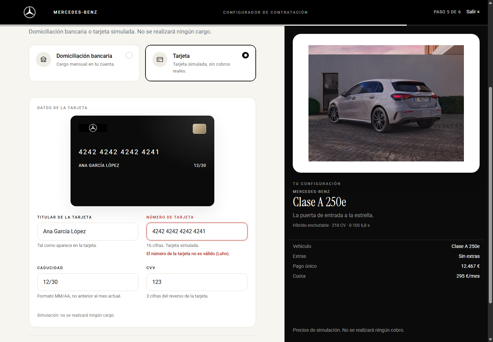

### Prueba 9 · Cambio de pago

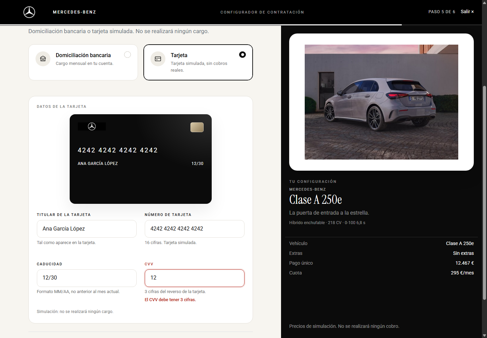

### Prueba 10 · Casillas

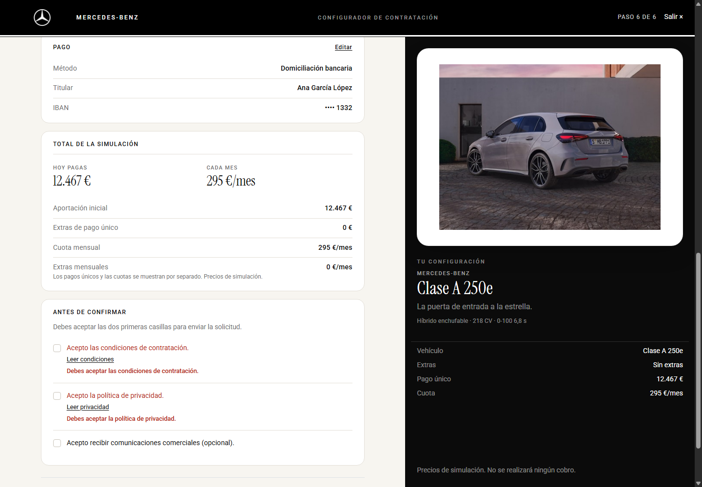

### Prueba 11 · KO y corrección

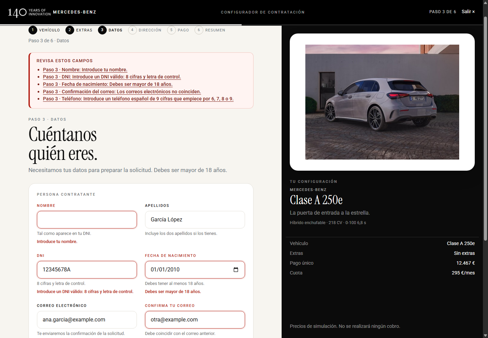

### Prueba 12 · Recorrido OK

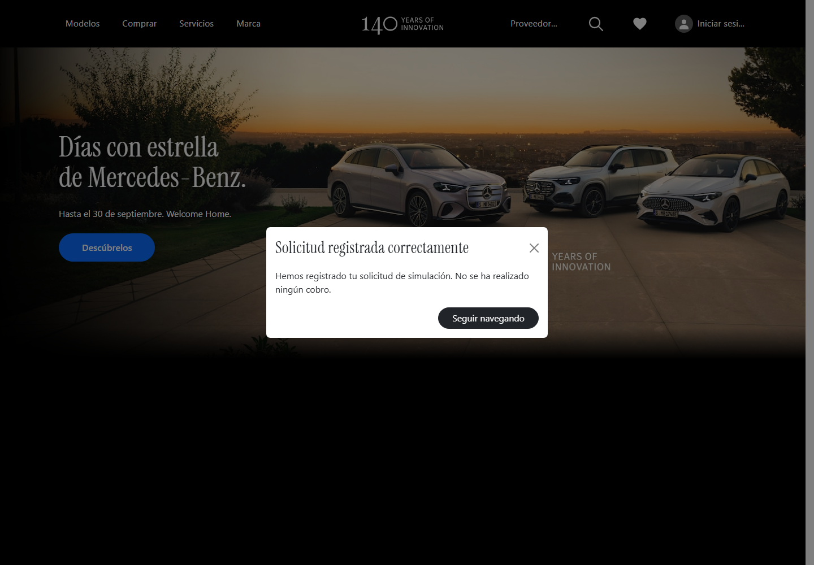

### Copia sin validación HTML

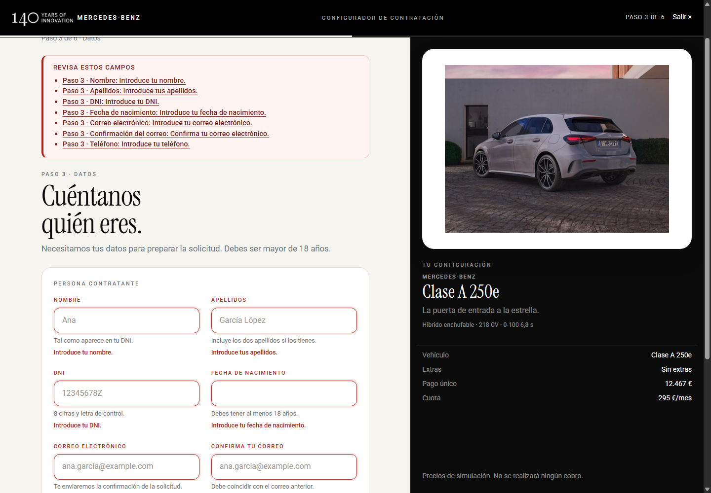

### Teclado

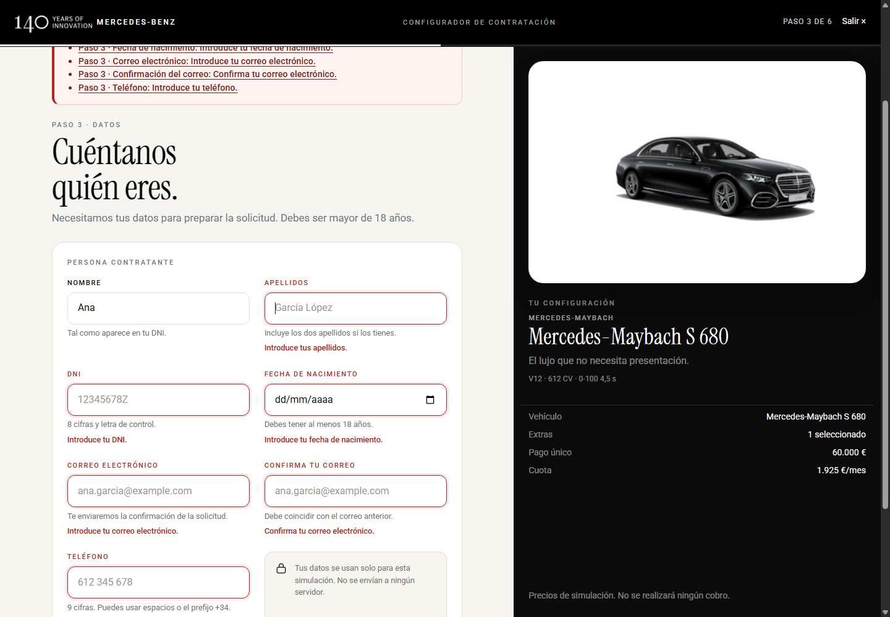

### Móvil 390 px

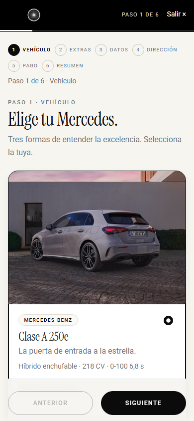

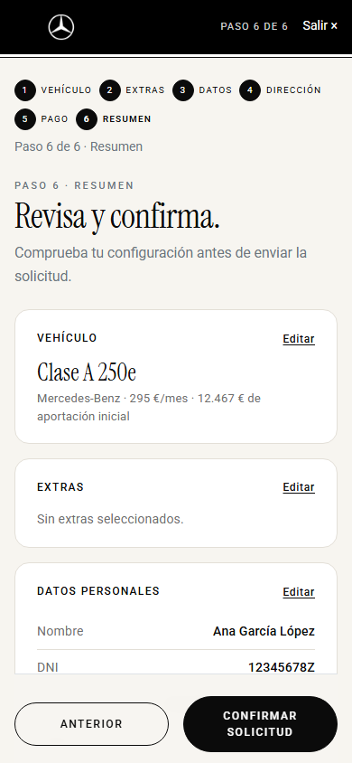


### Escritorio 1440 px

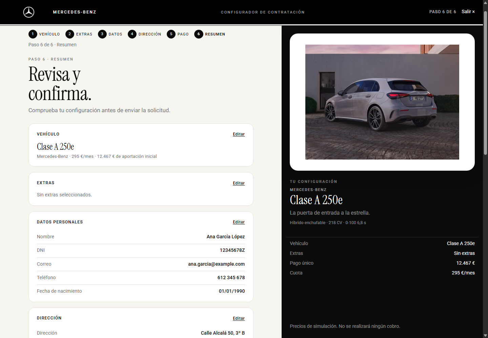

## 3. Copia sin validación HTML

Se generó una copia temporal de `contratacion.html` con estos cambios:

- Se eliminaron `required`, `pattern`, `min`, `max`, `minlength`, `maxlength` y `step` de los controles.
- Se eliminó `novalidate` del formulario.
- Los campos `type="email"`, `type="date"`, `type="tel"` y `type="number"` se convirtieron en `type="text"`.

Resultado de la comprobación en el DOM:

| Comprobación | Resultado |
|---|---|
| Elementos con `required` | 0 |
| Elementos con `pattern` | 0 |
| Formulario con `novalidate` | No |
| Tipo de `#email` | `text` |
| Tipo de `#fechaNacimiento` | `text` |

Con esa copia, el paso 3 vacío siguió mostrando `Introduce tu nombre.` y la tarjeta `4242 4242 4242 4241` siguió mostrando `El número de la tarjeta no es válido (Luhn).` Las funciones ejecutadas fueron `Validaciones.validarPaso()` → `validarPaso3()` → `validarRequerido()` para los vacíos y `Validaciones.validarPaso()` → `validarPaso5()` → `validarNumeroTarjeta()` para el algoritmo de Luhn. Por tanto, las comprobaciones que bloquean el avance son las de JavaScript, no las del navegador. La copia se eliminó al terminar la prueba.

Evidencia: [t13-13-sin-html.png](t13-13-sin-html.png).

## 4. Uso con teclado

Recorrido comprobado sin ratón:

- **Espacio** selecciona el vehículo; las **flechas** recorren el grupo de radios (`producto-clase-a` → `producto-amg` → `producto-maybach`).
- **Tab** sale del grupo de radios hacia `#btnSiguiente`; **Enter** avanza al paso 2.
- **Espacio** marca el extra `#extra-mantenimiento`; **Enter** avanza al paso 3.
- La escritura con teclado en `#nombre` introduce `Ana`; **Tab** pasa a `#apellidos`.
- Al validar con errores, el foco se mueve al primer campo incorrecto (`#apellidos`) y se muestra `Introduce tus apellidos.`
- El enlace **Leer condiciones** se abre con **Enter**; el modal se cierra con **Esc**.

Evidencia: [t13-14-teclado.png](t13-14-teclado.png).

## 5. Móvil y escritorio

| Vista | Pasos comprobados | Ancho de ventana | Ancho del documento | Resultado |
|---|---|---|---|---|
| Móvil | 1, 2, 3, 4, 5 y 6 | 390 px | 390 px en todos | Sin scroll horizontal |
| Escritorio | 6 | 1440 px | 1425 px | Sin scroll horizontal |

- En móvil se completó el recorrido entero hasta la confirmación y el modal se mostró correctamente.
- En escritorio se revisó el resumen final con el desglose de precios y el showroom.
- No se registraron errores de consola.

Evidencias: [paso 1 móvil](t13-15-movil-paso1.png), [paso 6 móvil](t13-15-movil-paso6.png), [modal móvil](t13-15-movil-modal.png), [escritorio](t13-16-escritorio.png).

## 6. Incidencias y conclusión

- **12/12 pruebas funcionales: OK.**
- **Copia sin validación HTML: OK.**
- **Teclado: OK.**
- **Móvil 390 px y escritorio 1440 px: OK, sin scroll horizontal.**
- **Consola: 0 errores.**
- No se han encontrado defectos funcionales en el recorrido final.

Observación de diseño: la incompatibilidad entre **Pack AMG Night** y **Pack Confort** se resuelve deshabilitando el extra incompatible y explicándolo en la propia tarjeta (`No compatible con Pack AMG Night.` / `No compatible con Pack Confort.`). Es una forma clara de bloquear la combinación sin dejar que el usuario llegue a un estado inválido.

El formulario queda listo para la integración final y la documentación de T14.

---

**Evidencias:** capturas `t13-01` a `t13-16` en `docs/`.<br>
**Commit de la tarea:** `test(SCRUM-18): realiza las pruebas funcionales` (hash en Jira SCRUM-18).<br>
**Rama:** `feat/pruebas`.
